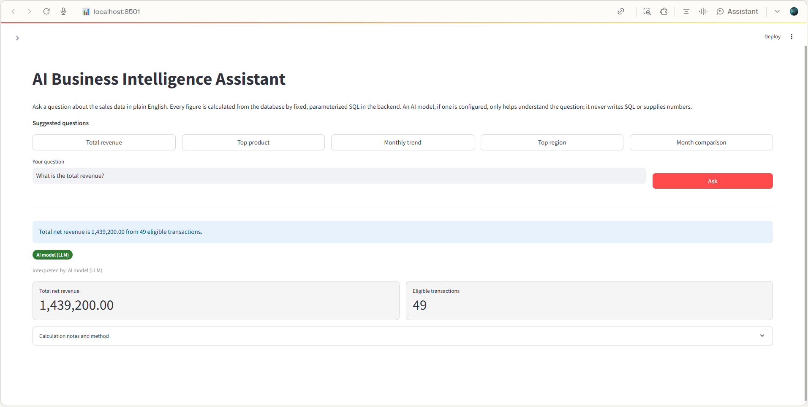
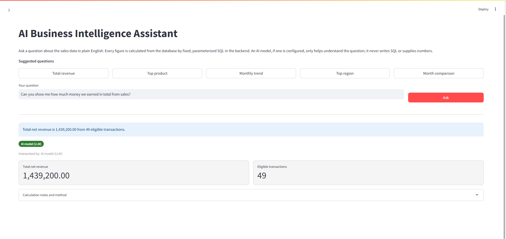
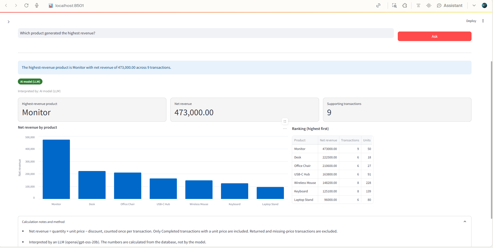
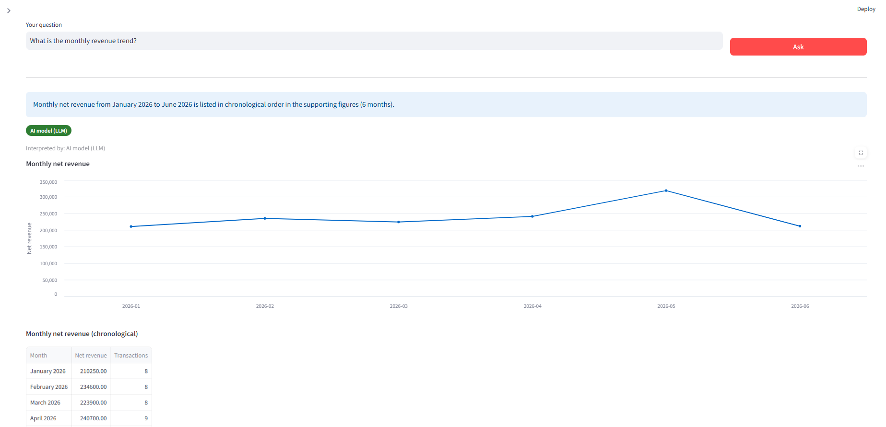
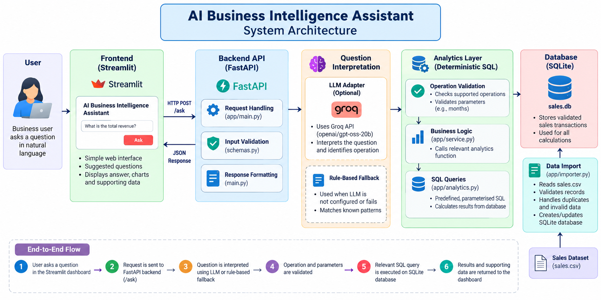

# 🚀 AI Business Intelligence Assistant

<p align="center">
  <strong>Ask questions in natural language. Get reliable, data-driven business insights.</strong>
</p>

<p align="center">
  
  
  
  
  
  
</p>

## 📌 Project Overview

The **AI Business Intelligence Assistant** is an AI-assisted analytics application that enables users to explore sales data by asking questions in natural language.

Instead of manually analysing spreadsheets or writing SQL queries, users can ask questions about revenue, product performance, regional sales, and monthly trends through an interactive dashboard.

The application uses a Large Language Model (LLM) to interpret questions, while **all numerical calculations are performed by deterministic backend logic using SQL and SQLite**. This separation improves reliability and reduces the risk of AI-generated numerical errors.

### 🎯 Project Objectives

- Simplify access to business intelligence through natural-language questions.
- Automate common sales analytics operations.
- Separate AI-based question interpretation from numerical calculations.
- Validate inputs and handle unsupported questions safely.
- Present business insights through a simple, interactive dashboard.

## ✨ Key Features

- 💬 **Natural-Language Queries:** Ask business questions in everyday language.
- 📊 **Sales Analytics:** Calculate total revenue, monthly trends, product rankings, and regional performance.
- 🤖 **AI-Powered Interpretation:** Optionally use the Groq API to interpret user questions.
- 🧮 **Reliable Calculations:** Execute predefined, parameterised SQL queries instead of relying on AI-generated figures.
- 📈 **Interactive Visualisations:** Display charts, tables, answer cards, and supporting figures.
- 🔄 **Fallback Mechanism:** Use rule-based interpretation when the LLM is unavailable or not configured.
- 🗂️ **Data Validation:** Validate imported CSV records and report data-quality issues.
- 🧪 **Automated Testing:** Test analytics, API endpoints, data imports, interpretation, and error handling.
- 🛡️ **Safe Question Handling:** Reject unsupported operations rather than inventing answers.

## 🖥️ Application Screenshots

### 🏠 1. Dashboard

The main dashboard provides an interface for entering business questions and viewing analytical results.



### 💰 2. Total Revenue Analysis

Displays the overall net revenue calculated from eligible transactions in the sales dataset.



### 🏆 3. Highest-Revenue Product

Identifies the product that generates the highest net revenue.



### 📅 4. Monthly Revenue Analysis

Displays monthly revenue trends and supports comparisons between two months, including absolute and percentage changes.



## 🏗️ System Architecture

The application follows a layered architecture that separates the frontend, API, question interpreter, business logic, and database.



### 🔍 How It Works

1. 👤 **User Input:** The user submits a natural-language question through Streamlit.
2. 🌐 **API Request:** Streamlit sends the question to the FastAPI backend through the `/ask` endpoint.
3. 🧠 **Question Interpretation:** The interpreter identifies the intended operation using the configured LLM or rule-based fallback.
4. ✅ **Validation:** The selected operation and its parameters are validated against the supported operations.
5. 🗃️ **Database Query:** The analytics layer executes predefined, parameterised SQL queries against SQLite.
6. 📊 **Result Generation:** The backend prepares the numerical results and supporting figures.
7. 🖥️ **Visualisation:** Streamlit displays the answer through cards, tables, and charts.

### 🤖 Role of the LLM

The LLM helps identify **what the user wants to calculate**, not the answer itself.

For example, when a user asks, “How much money did we make from sales?”, the model can interpret the question as `total_revenue`.

The backend then validates that operation and calculates the result from the database. The model does not generate executable SQL or supply the final revenue figure.

This design combines flexible question interpretation with deterministic analytics.


## 🛠️ Technology Stack

| Technology | Purpose |
|---|---|
| 🐍 Python | Core application logic |
| ⚡ FastAPI | Backend API and request validation |
| 🚀 Uvicorn | Runs the FastAPI application |
| 🗃️ SQLite | Relational database for sales data |
| 🔎 SQL | Revenue calculations and analytics |
| 🎨 Streamlit | Interactive dashboard |
| 🐼 pandas | Supporting data-table presentation |
| 🌐 httpx | HTTP communication with the backend |
| 🤖 Groq API | Optional LLM-based question interpretation |
| 🧪 pytest | Automated testing |

## 📂 Project Structure

```text
AI-Business-Intelligence-Assistant/
│
├── app/                       # Application source code
│   ├── analytics.py            # SQL-based analytics
│   ├── db.py                   # Database operations
│   ├── importer.py             # CSV validation and import
│   ├── interpreter.py          # Question interpretation
│   ├── llm.py                  # LLM provider integration
│   ├── main.py                 # FastAPI application
│   ├── question_router.py      # Rule-based fallback
│   ├── schemas.py              # Request/response schemas
│   ├── service.py              # Business logic
│   ├── settings.py             # Application settings
│   ├── ui.py                   # Streamlit dashboard
│   ├── ui_client.py            # API client for the UI
│   └── verify_llm.py           # LLM verification utility
│
├── data/
│   └── sales.csv               # Input sales dataset
│
├── docs/
│   └── analytics_policy.md     # Analytics and calculation rules
│
├── Screenshots/                # Application screenshots
│   ├── Dashboard.png
│   ├── Highest_Revenue.png
│   ├── Monthly_Revenue.png
│   └── Total_Revenue.png
|   └── System_Architecture.png
│
├── tests/                      # Automated test suite
├── .streamlit/                 # Streamlit configuration
├── .env.example                # Environment variable template
├── .gitignore                  # Git exclusion rules
├── AI_DEVELOPMENT_NOTES.md     # AI-assisted development notes
├── PROJECT_HANDOVER.md         # Project handover documentation
├── pytest.ini                  # pytest configuration
├── requirements.txt            # Python dependencies
└── README.md                   # Project documentation
```

*The structure above is a guide to the main files. Keep all additional modules and test files that exist in your actual project.*

## ⚙️ Installation and Setup

Follow these steps to run the application locally on Windows.

### 📋 Prerequisites

- Python 3.10 or newer.
- PowerShell or another terminal.
- Internet access to install Python dependencies.
- An optional Groq API key for LLM-based question interpretation.

### 1️⃣ Clone or Download the Repository

```powershell
git clone <YOUR_GITHUB_REPOSITORY_URL>
cd <YOUR_PROJECT_FOLDER>
```

Alternatively, download the repository as a ZIP, extract it, and open PowerShell in the folder containing `requirements.txt` and the `app` directory.

### 2️⃣ Create a Virtual Environment

```powershell
py -3 -m venv .venv
```

Activate it:

```powershell
.\.venv\Scripts\Activate.ps1
```

If PowerShell blocks activation, run the following command for your current Windows user and try activating again:

```powershell
Set-ExecutionPolicy -Scope CurrentUser RemoteSigned
```

### 3️⃣ Install Dependencies

```powershell
python -m pip install --upgrade pip
python -m pip install -r requirements.txt
```

### 4️⃣ Import the Sales Dataset

```powershell
python -m app.importer
```

This command validates the CSV records and creates or updates the local SQLite database.

With the supplied dataset and a fresh database, the expected initial import summary is 51 rows read, 51 accepted, and 49 revenue-eligible transactions.

The import process is designed to be idempotent, preventing identical transactions from being inserted repeatedly.

### 5️⃣ Start the FastAPI Backend

Open **Terminal 1** in the project root:

```powershell
.\.venv\Scripts\Activate.ps1
python -m uvicorn app.main:app --reload
```

The backend should be available at:

- 🌐 API: http://127.0.0.1:8000
- 📖 Interactive API documentation: http://127.0.0.1:8000/docs
- ❤️ Health check: http://127.0.0.1:8000/health

Keep this terminal running.

### 6️⃣ Start the Streamlit Dashboard

Open **Terminal 2** in the same project root:

```powershell
.\.venv\Scripts\Activate.ps1
python -m streamlit run app/ui.py
```

Open http://localhost:8501 in your browser if it does not open automatically.

**Important:** Keep both terminals running while using the application.

### 7️⃣ Ask Your First Question

Try entering:

```text
What is the total revenue?
```

You can also try the other supported questions listed below.

## 🤖 Configuring the Groq LLM (Optional)

The application can run without a configured LLM using its rule-based fallback. To enable LLM-based interpretation, follow these steps.

### 1️⃣ Create a Local Environment File

```powershell
Copy-Item .env.example .env
```

Open `.env` and configure the settings below, using the variable names expected by the application:

```dotenv
LLM_PROVIDER=groq
LLM_API_KEY=your_actual_groq_api_key
LLM_BASE_URL=https://api.groq.com/openai/v1
LLM_MODEL=openai/gpt-oss-20b
LLM_TIMEOUT_SECONDS=15
```

Replace the placeholder with your own API key. Check current provider availability and usage limits before use.

### 2️⃣ Restart the Backend

Stop the backend using `Ctrl+C`, then restart it:

```powershell
python -m uvicorn app.main:app --reload
```

### 3️⃣ Verify LLM Interpretation

```powershell
python -m app.verify_llm --yes
```

This performs a live provider check to verify that the model interprets a sample question as the `total_revenue` operation. It does not use the model to calculate revenue.

**🔐 Security reminder:** Never upload `.env`, API keys, passwords, or other secrets to GitHub. Commit `.env.example` with placeholder values only.

## 📊 Supported Analytics

The application currently supports five types of business questions.

| No. | Analytics | Example Question | Result |
|---:|---|---|---|
| 1 | 💰 Total Revenue | What is the total revenue? | Overall net revenue |
| 2 | 🏆 Highest-Revenue Product | Which product generated the highest revenue? | Top product and its revenue |
| 3 | 📈 Monthly Revenue Trend | Show the monthly revenue trend. | Revenue grouped by month |
| 4 | 🌍 Highest-Sales Region | Which region generated the highest sales? | Top region and its revenue |
| 5 | 📅 Month Comparison | Compare revenue between May and June. | Monthly values and changes |

The supplied dataset covers January through June 2026. Month comparisons must use available months, and the two months must be different.

Questions outside these supported operations are rejected rather than answered with fabricated analytics.

## 🧮 Revenue Calculation Rules

The application follows a consistent calculation policy:

**Net Revenue = (Quantity × Unit Price) − Discount Amount**

The discount is subtracted once per transaction.

- ✅ Only transactions with status `Completed` are included in revenue calculations.
- 🚫 Returned and other non-completed transactions are excluded from revenue totals.
- ⚠️ Transactions with missing unit prices are excluded from revenue calculations.
- 🔢 Zero-quantity transactions are retained and contribute zero before discount adjustment.
- ➖ Negative net revenue is permitted when the discount exceeds the gross transaction value.
- 💵 Monetary results are rounded to two decimal places.
- 📉 Percentage changes with a zero baseline are undefined and are labelled accordingly.
- 🗂️ Duplicate and conflicting transaction records are handled by the importer, with data-quality issues reported.

See [docs/analytics_policy.md](docs/analytics_policy.md) for the detailed policy.

## 🔌 API Documentation

The FastAPI backend exposes the following endpoints.

| Method | Endpoint | Description |
|---|---|---|
| `GET` | `/health` | Checks backend availability and interpreter status |
| `POST` | `/ask` | Accepts a natural-language question and returns analytics |
| `GET` | `/docs` | Opens interactive Swagger API documentation |

### Example API Request

Send a `POST` request to `/ask` with the following JSON body:

```json
{
  "question": "What is the total revenue?"
}
```

The successful response contains the interpreted operation, answer, numerical results, supporting figures, and calculation notes. The exact fields depend on the operation.

Explore the endpoints at http://127.0.0.1:8000/docs while the backend is running.

## 🧪 Testing

The project uses **pytest** to validate the application.

Run all automated tests from the project root:

```powershell
python -m pytest -q
```

For detailed test output:

```powershell
python -m pytest -v
```

### 🔍 Testing Coverage

- 🧮 Analytics calculations and aggregations.
- 📥 CSV validation, duplicate detection, and repeat imports.
- 🧠 Supported questions, invalid model responses, and fallback behaviour.
- 🤖 LLM adapter response parsing, provider failures, and timeouts.
- 🌐 API requests, invalid inputs, and unsupported questions.
- 🖥️ UI client behaviour and dashboard design checks.
- ⚠️ Edge cases, including invalid months, identical comparison months, missing values, and zero baselines.

Regular automated tests use mocked providers where appropriate and do not require a live Groq API request.

Run the suite against the final version before publishing. Report the actual passed and skipped counts rather than an unverified expected count.

## 🛡️ Error Handling and Safety

- Validates incoming questions and operation parameters.
- Restricts requests to supported analytics operations.
- Uses predefined, parameterised SQL rather than model-generated SQL.
- Handles invalid model output and provider failures.
- Uses a fallback interpreter where appropriate.
- Returns structured errors for invalid requests and unsupported questions.
- Prevents the application from inventing figures for unsupported analytics.

The project is intended for local demonstration and does not currently implement user authentication.

## ⚠️ Limitations

- Only five analytics operations are supported.
- Rule-based interpretation may not understand every possible question phrasing.
- LLM interpretation depends on provider availability, configuration, and model behaviour.
- The supplied dataset is limited to January–June 2026.
- Arbitrary SQL queries and unrestricted analytics are not supported.
- Additional security and operational controls are needed before public production deployment.

## 🔮 Future Enhancements

- 📊 Add more analytics operations and configurable date ranges.
- 🧠 Improve interpretation of different question phrasings.
- 📈 Introduce additional business visualisations.
- 🔐 Implement authentication and access control.
- 🐳 Support Docker-based deployment.
- 🧪 Expand automated tests as new features are added.
- 📡 Add application logging and operational monitoring.

## 🤝 AI-Assisted Development

AI tools were used as development assistants for implementation, debugging, and refinement. Changes were reviewed and tested during development.

At runtime, the optional LLM interprets questions. The backend remains responsible for validation, database access, calculations, and numerical results.

For further details about tools used, debugging challenges, verification, and potential improvements, see [AI_DEVELOPMENT_NOTES.md](AI_DEVELOPMENT_NOTES.md).

## 👩‍💻 Author

**Mannay Krithika**

AI Business Intelligence Assistant — combining natural-language question interpretation with reliable, SQL-backed business analytics.

---

<p align="center">
  ⭐ If you find this project interesting, consider giving the repository a star!
</p>
